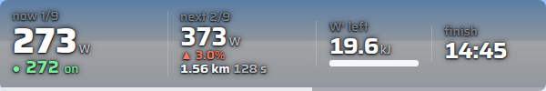
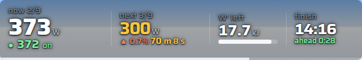
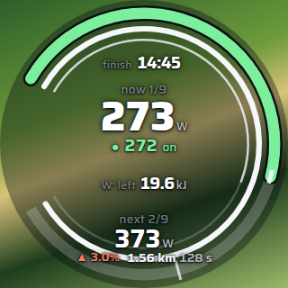
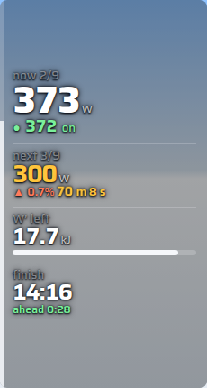
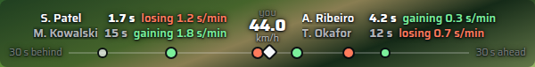
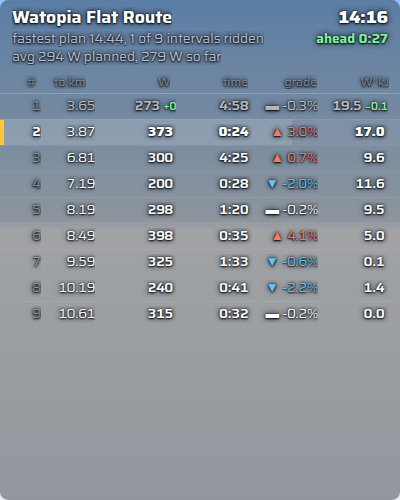
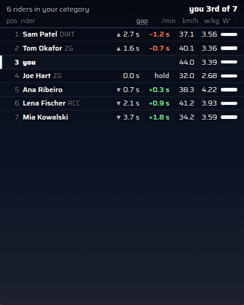
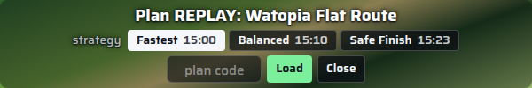

# ZwiftGopher TT for Sauce for Zwift

A Sauce for Zwift mod that rides a [ZwiftGopher TT plan](https://zwiftgopher.com/TT/)
with you: the power to hold now, the next change and when it comes, the W′ you have left
and the finish time you are on for, drawn over the game.

## Installing

1. Download the zip of the [latest release](https://github.com/BlueHorizon157/zwiftgopher-s4z-mods/releases/latest).
2. Unzip it into the `SauceMods` folder in your Documents (create the folder if it is not
   there), so that `Documents/SauceMods/zwiftgopher-s4z-mods/manifest.json` exists.
3. Restart Sauce for Zwift (2.0 or later), and under settings → Mods enable **ZwiftGopher TT**.
4. Add the windows below from Sauce's window menu.

**Updating from 0.6:** replace the old folder. The mod has a new id from 0.7, so the old
windows are gone: add the new ones, and enter your plan code again.

## Windows

Add any of these from Sauce's window menu (right-click the Sauce icon → Windows):

| Window | What it is |
|---|---|
| **TT HUD: strip** | One line for the top of the screen (600 × 100): now, next, W′, finish. |
| **TT HUD: dial** | A round gauge (320 × 320): live power against the target band on the ring, W′ on the inner ring, the next change below. |
| **TT HUD: stack** | A narrow column for a screen edge (230 × 430). |
| **TT interval list** | Every interval with where it ends, its target, time, gradient and W′, and how each one went. |
| **TT field** | The riders of your event in standings order, with the gap at equal distance and the time you gain or lose on each. |
| **TT rivals** | One line for a screen edge (600 × 76): the riders nearest you on the road, ahead and behind. |

The three HUDs show the same things in different shapes; add the one you like. Each
window runs on its own, so they always agree.




 



 

## Loading a plan

1. In the planner, open your plan's **Share** page and press **Copy code**.
2. Click the HUD: it offers **Load ABC123** with the code from your clipboard. You can also
   type the code into the box (it is there whenever no plan is loaded) or paste the share
   link.
3. The HUD says *ready* with the route's name. In the pen it counts down to the start; the
   clock starts when you cross the timing line.

Codes last seven days. The newest five plans are kept in the mod (settings → Plans) and the
one made for the event's route is picked for you. To load another plan while one is active,
hover the HUD and press **Plan** (a code on the clipboard is offered in the tray too).

### Choosing a strategy

An optimised plan carries the optimiser's three ways to ride it: *Fastest*, *Balanced* and
*Safe finish*. Before the start the HUD's top line shows the one you are on; click it (or
**Plan** in the tray, or settings → Plans) and pick another. Every window rides the new one.
Once the race starts the choice is locked, so the race HUD never changes under you; a change
made on the settings page during a race waits until it is over.



## Reading the HUD

- **now** is the target for the interval you are in, with your live power beside it in the
  band colour: blue ▼ under, green ● on, orange ▲ over (the word is there too).
- **next** is the next target with its gradient and how far and how long until it starts.
  Ten seconds before the change it turns amber and the countdown pulses.
- **W′ left** is the planner's own W′ balance model run on your live power, with the plan's
  floor marked on the bar. It turns red under 25 %.
- **finish** is the time you are on for, and in words how that compares with the plan:
  *on plan*, *ahead 0:12*, *behind 0:40*. Before the start it shows the plan's time; after
  the finish, your time.

Hover the HUD for the tray: **offset** (nudge the plan ±10 m if its boundaries come early or
late), **bias** (every target ±1 %), **Reset** (clear this race's statistics), **Plan** (the
plan panel: strategy and code) and settings.

## The list, the field and the rivals strip

The **interval list** shows each interval's end (in km), target, time, gradient and the W′
the plan leaves you with. The current interval leads with a bar that fills as you ride it,
a third of the way down so you see what is coming. Once an interval is ridden, small figures
show how it went: your average against the target in the band colours, the time against the
plan, and your W′ against the plan's (orange: you spent more than planned).

The **field** lists the riders of your category in order of the time each took to the same
point of the course. The gap is measured at equal distance: where both of you have been,
every 50 m, so it compares like with like.
By default it is the gap on the clock (in a TT riders start apart, so a rider behind you on
the road can be ahead on time); click *gap* to switch to the road. The next column is the
time you gained (+, green) or lost (−, orange) on each rider per minute over the last minute.
Your row stays in view.

The **rivals strip** is for a glance: behind you on the left, ahead on the right. For the
nearest riders each side it gives how far up or down the road they are, whether you are
*gaining*, *holding* or *losing* on them and by how much a minute, and their speed over the
last part of the plan you have both ridden (green when slower than yours). Below, everyone
around you sits on a track by their gap.

The field and the rivals strip need an event: outside one, riders have no shared distance to
compare.

In a group ride or race there is no timing line: the clock runs from the start and the HUD
says so. Riding the planned route outside an event, the plan arms itself on the route and
the clock starts when you do.

## Settings

Right-click any window for Sauce's titlebar and its settings button (the HUD also has one in
its tray). One settings page serves every window and shows what that window uses. Plans:
the library, code entry and the active plan's strategy. Look: background (clear, smoke, dark, solid), halo strength,
size, and for the HUD its layout, band words and cadence/HR/speed. Pacing: power smoothing,
on-target band, look-ahead, the amber warning time, how the clock starts. Field: gap on the
clock or the road, every category. Rivals: riders named each side. Advanced: debug log, the
telemetry recorder.

## Development

```
npm test                       # engine, kernel, plan and page tests (node --test)
node scripts/page-check.mjs    # the windows in headless Chrome against a running Sauce
```

The engine (`pages/src/engine/`) is pure and runs in Node; the windows are views over it.
Any window takes `?replay=<recording>&plan=<plan>&speed=20` to replay a telemetry recording
from `pages/fixtures/` instead of live data (`&seek=<s>` fast-forwards, `&bg=snow|jungle|night`
paints a stand-in background). The synthetic recordings come from
`scripts/make-synthetic-telemetry.mjs`, with six made-up rivals for the field windows.
Settings → Advanced → *Record telemetry* records a real ride for that purpose.
`node scripts/page-check.mjs --out=docs/screenshots` regenerates the screenshots above (it
writes every moment; the README uses a few). `docs/REVAMP_PLAN.md` is the plan and the audit; `scripts/release.sh`
builds the release zip from a tag.
