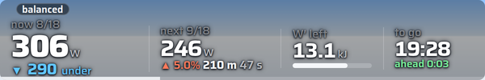
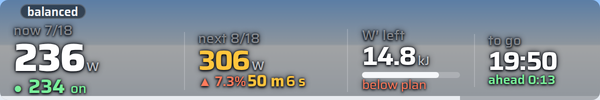
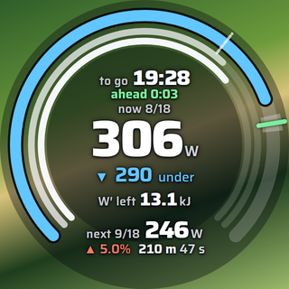
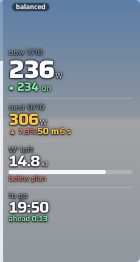
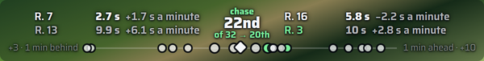
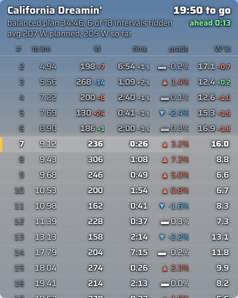
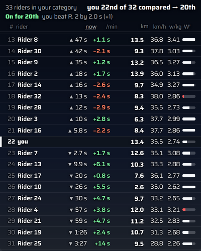
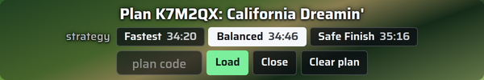

# ZwiftGopher TT for Sauce for Zwift

A Sauce for Zwift mod that rides a [ZwiftGopher TT plan](https://zwiftgopher.com/TT/)
with you: the power to hold now, the next change and when it comes, the W′ you have left
and the time to go against your plan, drawn over the game.

**New to it?** The [Race HUD guide](https://zwiftgopher.com/TT/guide.php) walks through both
ends step by step with pictures: install, link once, pick your event in the planner, ride.

## Installing

1. Download the zip of the [latest release](https://github.com/BlueHorizon157/zwiftgopher-s4z-mods/releases/latest).
2. Unzip it into the `SauceMods` folder in your Documents (create the folder if it is not
   there), so that `Documents/SauceMods/zwiftgopher-s4z-mods/manifest.json` exists.
3. Restart Sauce for Zwift (2.0 or later), and under settings → Mods enable **ZwiftGopher TT**.
4. Add the windows below from Sauce's window menu.

**Updating from 0.6:** replace the old folder. The mod has a new id from 0.7, so the old
windows are gone: add the new ones, and enter your plan code again.

## Windows

Add any of these from Sauce's window menu (right-click the Sauce icon → Windows):

| Window | What it is |
|---|---|
| **TT HUD: strip** | One line for the top of the screen (600 × 100): now, next, W′, finish. |
| **TT HUD: dial** | A round gauge (320 × 320) open at the bottom. Rings from the outside in: live power against the target (bold green tick) and the next target (dashed tick); time left in the interval, draining to the change and amber in the warning time; W′ left with the plan's floor. Inside: the finish, the target, your live power and W′; the next change sits in the opening. |
| **TT HUD: stack** | A narrow column for a screen edge (230 × 430). |
| **TT interval list** | Every interval with where it ends, its target, time, gradient and W′, and how each one went. |
| **TT field** | The riders of your event on the clock, with the gap at the same distance along the course (like for like), your place among them, and the time you gain or lose on each. |
| **TT rivals** | One line for a screen edge (600 × 76): the riders nearest you on the clock, ahead and behind, with the gap and how it moves; green a target, red a threat. |

The three HUDs show the same things in different shapes; add the one you like. Each
window runs on its own, so they always agree.




 



 

## Loading a plan

1. In the planner, open your plan's **Share** page and press **Copy code**.
2. Click the HUD: it offers **Load ABC123** with the code from your clipboard. You can also
   type the code into the box (it is there whenever no plan is loaded) or paste the share
   link.
3. The HUD says *ready* with the route's name. In the pen it counts down to the start; the
   clock starts when you cross the timing line.

Codes last seven days. The newest ten plans are kept in the mod (settings → Plans) and the
one made for the event's route is picked for you. To load another plan while one is active,
hover the HUD and press **Plan** (a code on the clipboard is offered in the tray too).

### Linking to the planner

Link once and the codes go away: in the HUD's settings, under **Plans**, press **Link to the
planner**. The HUD shows a six-letter pairing code (ten minutes). In the planner, open your
plan's **Share** dialog, press **Link Sauce** and type the code. From then on every plan you
optimise in that browser arrives in the mod by itself, within a minute, while a HUD window is
open and no race is running. A plan comes up where it belongs: in its event's pen, or on its
route on a free ride. Anywhere else the HUD offers it (*new plan: Urumaze · 14:57*, **Use**)
and **Use** loads it now, say to look it over while warming up on another route. An edited
plan sent again under the same code replaces the one loaded before the start. The planner
shows *Sauce has it ✓* once the mod has saved the plan. Nothing arrives while you race.

The link is a token the mod keeps for itself; the planner keeps only its hash, and either side
can end it (settings → Plans → **Unlink**, or the planner's Devices list). Linking needs the
planner update of November 2026; until then the settings page says so and codes work as
before.

### Events

A plan made from the planner's event picker knows its event. When you join that event's pen,
the HUD arms the plan by itself before the start; failing a plan for the event, it arms the
plan for the same route with the same laps, or within 1 % of a distance event's length. With
no plan for the event, a plan for another course is put away rather than raced there (load it
again from the list to ride it anyway). On a free ride with nothing loaded, the newest plan for
the route you are on comes up. A plan you choose by hand after joining stays, and so does
**Clear plan** (the plan panel): the pen or the route does not bring the plan back. With nothing happening, the plan panel shows the
next time trial you are signed up for (*next TT: Urumaze 19:20 (in 42 min) · plan ready*),
from what Sauce has loaded (about four hours ahead) and from the plans the planner sent; the
settings page lists them. While linked, the mod tells the planner which events you signed up
for, so the picker marks them.

### Plan it

Signed up but no plan? Linked, the next-TT line (and, in the pen, *this event: … · no plan
yet*) has **Plan it**: the planner builds an optimised plan for that event with your last
planner settings (or its defaults: settings → Advanced → *Plan it uses*), in a few seconds,
and the HUD arms it. The plan is on your shelf like any other, so the planner's Load dialog
opens it for tuning. Six plans an hour, twenty a day; the planner itself is not limited that
way.

### Plan from here

Riding with no plan: dropped, clear on your own, or on a free ride? Linked, the plan panel has
**Plan from here** with how far there is to go (*to the finish · 8.6 km* in a race, *to the
end of the lap · 12.3 km* on a free ride on a route). The planner plans the rest from where
you are and the HUD rides it at once, measured from the moment you pressed, on *Balanced*
(settings → Advanced → *Plan from here starts on*; the strategy chip changes it any time).

- **What the ride has cost you.** The power Sauce kept for the ride goes with the request:
  the planner replays it for the W′ you have left, and takes your NP so far with the time the
  rest will take for how much of your CP is left. The W′ bar starts where you are.
- **The bike.** A road bike, unless the event is no-draft or you have raced it with no draft
  at all (TT bikes get none). Any draft is a road bike. Settings → Advanced → *Plan from
  here's bike* can say Road or TT for good.
- **Where it applies.** Races by distance once they have started, and free rides on a route
  (the plan ends where the route's lap does). Not a race ridden for a time, not a free ride
  with no route, not the last 500 m.
- **For this ride only.** Leave the race or the route and the plan is put away. With a plan
  from here running, the plan panel (**Plan** in the tray) offers it *again from here*: the
  planner replays the whole ride, so the new plan starts from the W′ you have now. Over any
  other plan, pick a safer strategy, turn the tray's **bias** down, or **Clear plan** and plan
  from here. The banner reads *from here · road bike*, with *tired legs* when the ride has
  taken some of your CP.

It shares Plan it's six plans an hour.

### Choosing a strategy

An optimised plan carries the optimiser's three ways to ride it: *Fastest*, *Balanced* and
*Safe finish*. The HUD's top line shows the one you are on; click it (or **Plan** in the
tray, or settings → Plans) and pick another, before the start or during the race. Every window
rides the new one. During a race the targets change in place: the clock, your position and
your W′ carry on, and the interval you are in starts its statistics again. A plan edited in
the planner during a race waits until it is over.



## Reading the HUD

- **now** is the target for the interval you are in, with your live power beside it in the
  band colour: blue ▼ under, green ● on, orange ▲ over (the word is there too).
- **next** is the next target with its gradient and how far and how long until it starts.
  The seconds count down in real time: they come from the plan's time for the rest of the
  interval (where in the interval that time goes, from a plan made after 10 November 2026:
  a flat interval that ends on a climb spends most of it at the end), adjusted for the power
  you have ridden in it and for how your speed has compared with the plan's over the last few
  minutes (a draft), not from your speed this moment, so a hill inside the interval does not
  make them jump. The dial's time ring and the progress bar
  run on the same clock. Ten seconds before the change it turns amber and the countdown pulses. The target
  switches exactly when the countdown reaches zero: the plan's boundaries are where the
  change pays, so the HUD never moves them, and the warning is yours to use.
- **W′ left** is the planner's own W′ balance model run on your live power, with the plan's
  floor marked on the bar. It turns red under 25 %.
- **to go** is the time left to the finish line at the pace you are riding, and beside it, in
  words, how you compare with the plan: *on plan*, *ahead 0:12*, *behind 0:40*. Prefer the
  predicted finish time? Settings → Pacing → *Finish shows* → *Predicted finish time*. Before
  the start it shows the plan's time; after the finish, your time.

Hover the HUD for the tray: **offset** (nudge the plan ±10 m if its boundaries come early or
late), **bias** (every target ±1 %), **Reset** (clear this race's statistics), **Plan** (the
plan panel: strategy and code) and settings.

## Where you are on the course

In a TT the game's distance starts at the timing line, and the line is not at the start of
the course's road data: it sits up to about 160 m into it on some routes, and no rule finds it.
A plan made after the planner's course update carries the course itself. The mod
matches your position (your latitude and longitude) against that course: after four
consistent fixes on the road it knows where the line is and where you are on the plan, to
about 5 m, and the game's distance carries you between fixes. If the position is lost for a
stretch (up to 600 m of game distance), the plan metre runs on from the last match by the game's
distance until the road is found again. On California Dreamin' the match locks about 40 m after the line. The plan's intervals switch where you reach them, and the
finish is the event's length.

Plans made before that update have no course. They keep the old rule, which places the line
from the event's length or from the plan file, and that can be out by up to about 160 m on
some routes: the intervals then switch late by that much. Plan the race again to get the
matching.

## The list, the field and the rivals strip

The **interval list** shows each interval's end (in km), target, time, gradient and the W′
the plan leaves you with. The current interval leads with a bar that fills as you ride it,
a third of the way down so you see what is coming. Once an interval is ridden, small figures
show how it went: your average against the target in the band colours, the time against the
plan, and your W′ against the plan's (orange: you spent more than planned).

The **field** lists the riders of your event in order of the gap on the clock. The gap is
measured at the same distance along the course, where you have both been, so it compares like
with like. In a TT riders start apart, so a rider behind you on the road can be ahead on the
clock. Each rider's place is their rank among the riders you can compare with, you included.
A rider who has finished keeps their time: it is frozen at the line on their own clock, and
their place is among the finishers. Riders you cannot yet compare, or have not seen for two
minutes, sit below a divider with the reason. Click *gap* to switch between the gap now and
the gap at the finish (predicted from the pace of the last minutes). The next column is the
time you gain (+, green) or lose (−, orange) on each rider a minute, over the last four minutes
(the last minute until four have passed), so a sprint barely moves it. The header sums you up:
*you 5th of 18 compared*, with the place you are heading for (*→ 4th*) once the outlook has
settled. After you finish it reads *you finished 2nd of 3 so far*.

The finish outlook predicts each rider's gap to the line at their pace, using your own time to
go from the plan (which knows the route), so no rider is modelled on the course. It is not
shown until 20 minutes of racing or five minutes to go: before that the middle of the rivals
strip shows your place only. Once it has settled, one word sits in the middle of the rivals
strip and under the field header:

| Verdict | When |
|---|---|
| *Clear* | nobody close at the finish either way: ride your plan |
| *Defend 4th* | someone beats you, or finishes close behind (*J. Hart 3 s back at the finish, closing 0.8 s/min*) |
| *Chase 3rd* | you beat someone, or one finishes close ahead (*S. Patel 6 s up at the finish: +0.9 s/min catches them*) |
| *Contested* | both |

The **rivals strip** is for a glance: the riders nearest you on the clock, behind on the left and
ahead on the right. Each side names the two nearest riders with the gap now and how many seconds a
minute you gain (+) or lose (−) on them, at the pace of the last four minutes (a sprint barely
moves it). **Colour marks only the riders in play**, on the name and the dot: **green** is a
target (ahead of you, and at this pace you finish ahead of them or close behind), **red** a threat
(behind you, and at this pace they finish ahead of you or close behind). Close is a second per
minute to go, 5 to 30 s. Everyone else stays plain: a rider far behind and falling away, or far
ahead and pulling away, is no concern. A rider is called once they have a pace (90 s of shared
history); the colours are faint until the outlook settles (20 minutes of racing or five to go),
and nobody is called once you have finished. Hover a name or a dot for the call in words. In the
middle, your place among the riders you can compare with, with the verdict once it has settled
and the place you are heading for under it; hover it for the reason. Outside a race it shows your
speed. Below, everyone around you sits on a track by their gap on the clock: a dot each, your own
in the middle, a finished rider a hollow dot.
The track reaches ±1 min by default. Settings → Rivals → *Track range* fixes it at ±30 s, ±1, ±2
or ±5 min, or fits the whole field; its ends count the riders beyond the range on each side.

The field and the rivals strip need an event: outside one, riders have no shared distance to
compare.

In a group ride or race there is no timing line: the clock runs from the start and the HUD
says so. Riding the planned route outside an event, the plan arms itself on the route and
the clock starts when you do.

## Settings

Right-click any window for Sauce's titlebar and its settings button (the HUD also has one in
its tray). One settings page serves every window and shows what that window uses. Plans:
the library, code entry and the active plan's strategy. Look: background (clear, smoke, dark, solid), halo strength,
size, and for the HUD its layout, band words and cadence/HR/speed. Pacing: power smoothing,
on-target band, the amber warning time, how the clock starts. Field: gap now or at the
finish, every category. Rivals: the track range. Advanced: what Plan it
plans with, Plan from here's bike and the strategy it starts on, debug log, the telemetry recorder.

## Development

Screenshots without Sauce: `scripts/sauce-standin/server.mjs` serves the windows with a
stand-in for Sauce's `common.mjs`, and `scripts/guide-shots.mjs` pairs them with a local
planner and captures the guide's pictures (`--out=../ZwiftGopher/TT/images/guide --webp`).

```
npm test                       # engine, kernel, plan and page tests (node --test)
node scripts/page-check.mjs    # the windows in headless Chrome against a running Sauce
```

The engine (`pages/src/engine/`) is pure and runs in Node; the windows are views over it.
Any window takes `?replay=<recording>&plan=<plan>&speed=20` to replay a telemetry recording
from `pages/fixtures/` instead of live data (`&seek=<s>` fast-forwards, `&bg=snow|jungle|night`
paints a stand-in background). The synthetic recordings come from
`scripts/make-synthetic-telemetry.mjs`, with six made-up rivals for the field windows.
Settings → Advanced → *Record telemetry* records a real ride for that purpose.
`node scripts/page-check.mjs --out=docs/screenshots` regenerates the screenshots above (it
writes every moment; the README uses a few). `docs/REVAMP_PLAN.md` is the plan and the audit; `scripts/release.sh`
builds the release zip from a tag.
